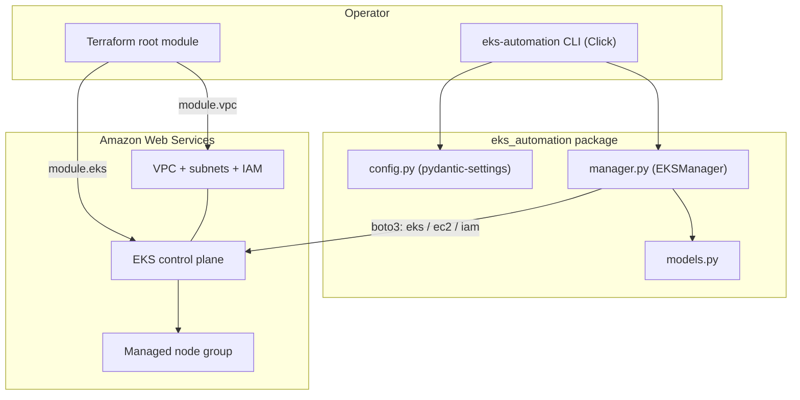

# EKS Automation

[](LICENSE)
[](https://github.com/abhisheksawant52/eks-automation/actions/workflows/ci.yml)
[](https://www.python.org/)
[](https://developer.hashicorp.com/terraform)

End-to-end tooling for provisioning and operating **AWS Elastic Kubernetes
Service (EKS)** clusters. It pairs a typed, boto3-based Python CLI for day-two
operations with a modular Terraform stack that stands up the cluster, managed
node groups, and supporting VPC networking.

---

## Overview

`eks-automation` gives platform and DevOps engineers a single, coherent way to
manage the full EKS lifecycle. The **Terraform** layer is the source of truth for
infrastructure — VPC, subnets, IAM roles, the control plane, and a managed node
group — organised into reusable modules with `dev` and `prod` environments. The
**Python CLI** (`eks-automation`) wraps the EKS, EC2, and IAM APIs for ongoing
operations that don't belong in a plan/apply cycle: describing clusters, scaling
node groups, upgrading Kubernetes versions, and generating a kubeconfig.

Both layers share the same defaults (region, cluster name, Kubernetes version,
node sizing) so infrastructure and operational tooling stay consistent. The CLI
uses the standard AWS credential chain, making it equally at home on a laptop, in
CI, or on an instance/role.

This project is a scaffold: it is structured and syntactically complete, but the
AWS calls require valid credentials and a real account to execute.

---

## Architecture



**Components**

- **CLI (`cli.py`)** — Click command group exposing `create`, `delete`, `list`,
  `describe`, `scale`, `upgrade`, and `kubeconfig`.
- **Manager (`manager.py`)** — `EKSManager`, the typed boto3 wrapper.
- **Config (`config.py`)** — `pydantic-settings` model reading `EKS_*` variables.
- **Terraform modules** — `modules/vpc` and `modules/eks`, composed by the root
  module and parameterised per environment.

---

## Features

- Full cluster lifecycle from the command line: create, describe, list, delete.
- Managed node group creation, scaling, and Kubernetes version upgrades.
- `wait_for_active` helper backed by the EKS `cluster_active` waiter.
- kubeconfig generation using the `aws eks get-token` exec plugin.
- Typed configuration via `pydantic-settings` with `.env` support.
- Modular Terraform (VPC + EKS) with `dev`/`prod` environment examples and a
  partial S3/DynamoDB backend template.
- CI with linting, a Python test matrix, and Terraform `fmt`/`validate`.
- Slim, non-root Docker image packaging the CLI.

---

## Tech Stack

| Layer            | Technology                                            |
| ---------------- | ----------------------------------------------------- |
| Language         | Python 3.11+                                          |
| AWS SDK          | boto3 / botocore                                      |
| CLI framework    | Click                                                 |
| Configuration    | pydantic-settings                                     |
| Infrastructure   | Terraform (`hashicorp/aws` ~> 5.0)                    |
| Tooling          | ruff, black, pytest, pre-commit, GitHub Actions       |

---

## Getting Started

### Prerequisites

| Tool      | Version | Install                                                        |
| --------- | ------- | -------------------------------------------------------------- |
| Python    | 3.11+   | [python.org](https://www.python.org/downloads/)               |
| Terraform | 1.5+    | [developer.hashicorp.com](https://developer.hashicorp.com/terraform/install) |
| AWS CLI   | 2.x+    | [aws.amazon.com/cli](https://aws.amazon.com/cli/)             |
| kubectl   | 1.30+   | [kubernetes.io](https://kubernetes.io/docs/tasks/tools/)      |

### Install

```bash
git clone https://github.com/abhisheksawant52/eks-automation.git
cd eks-automation

make install          # editable install with dev dependencies
cp .env.example .env   # then edit values as needed
```

### Configure

The CLI reads configuration from `EKS_*` environment variables (or `.env`) and
uses the standard AWS credential chain. See the [Configuration](#configuration)
table below.

```bash
export AWS_PROFILE=my-profile        # or configure keys via `aws configure`
export EKS_AWS_REGION=us-east-1
```

### Run

```bash
# Provision infrastructure
terraform -chdir=terraform init
terraform -chdir=terraform apply -var-file=environments/dev/dev.tfvars.example

# Operate the cluster with the CLI
eks-automation list
eks-automation describe --cluster-name eks-automation-dev
eks-automation scale --cluster-name eks-automation-dev \
  --nodegroup-name eks-automation-dev-nodes --desired-size 4
eks-automation kubeconfig --cluster-name eks-automation-dev > kubeconfig.yaml
```

---

## Project Structure

```text
eks-automation/
├── src/eks_automation/
│   ├── __init__.py          # package metadata (__version__)
│   ├── cli.py               # Click entrypoint (eks-automation)
│   ├── config.py            # pydantic-settings configuration
│   ├── logging_config.py    # centralised logging setup
│   ├── manager.py           # EKSManager (boto3 wrapper)
│   ├── models.py            # typed views over EKS API responses
│   └── exceptions.py        # domain exceptions
├── tests/                   # pytest suite (config, models, CLI)
├── terraform/
│   ├── versions.tf providers.tf main.tf variables.tf outputs.tf
│   ├── terraform.tfvars.example
│   ├── modules/vpc/         # VPC, subnets, routing
│   ├── modules/eks/         # IAM, control plane, node group
│   └── environments/        # dev/ and prod/ tfvars + backend configs
├── kubernetes/deployment.yaml   # sample workload to smoke-test the cluster
├── ansible/site.yml
├── .github/workflows/           # ci.yml + eks-deploy.yml
├── Dockerfile
├── Makefile
└── pyproject.toml
```

---

## Configuration

All variables are optional and prefixed with `EKS_`. Defaults come from
[`.env.example`](.env.example).

| Variable                  | Default                  | Description                              |
| ------------------------- | ------------------------ | ---------------------------------------- |
| `EKS_AWS_REGION`          | `us-east-1`              | AWS region for all operations            |
| `EKS_AWS_PROFILE`         | _(unset)_                | Named AWS profile (else credential chain)|
| `EKS_CLUSTER_NAME`        | `eks-automation-cluster` | Default cluster name                     |
| `EKS_KUBERNETES_VERSION`  | `1.30`                   | Target Kubernetes version                |
| `EKS_NODE_INSTANCE_TYPES` | `t3.medium`              | Comma-separated EC2 instance types       |
| `EKS_NODE_MIN_SIZE`       | `1`                      | Minimum node count                       |
| `EKS_NODE_MAX_SIZE`       | `10`                     | Maximum node count                       |
| `EKS_NODE_DESIRED_SIZE`   | `2`                      | Desired node count                       |
| `EKS_NODE_AMI_TYPE`       | `AL2023_x86_64_STANDARD` | Managed node group AMI type              |
| `EKS_LOG_LEVEL`           | `INFO`                   | Logging verbosity                        |

---

## Deployment

Infrastructure is deployed with Terraform. The root module composes the `vpc` and
`eks` modules; environment values live under `terraform/environments/`.

```bash
# Development
terraform -chdir=terraform init -backend-config=environments/dev/backend.hcl
terraform -chdir=terraform apply -var-file=environments/dev/dev.tfvars.example

# Production
terraform -chdir=terraform init -backend-config=environments/prod/backend.hcl
terraform -chdir=terraform apply -var-file=environments/prod/prod.tfvars.example
```

The [`eks-deploy.yml`](.github/workflows/eks-deploy.yml) workflow runs
`terraform plan` on pull requests and gated `apply`/`destroy` on `main` via a
`production` environment. A sample workload is provided in
[`kubernetes/deployment.yaml`](kubernetes/deployment.yaml):

```bash
aws eks update-kubeconfig --name eks-automation-dev --region us-east-1
kubectl apply -f kubernetes/deployment.yaml
```

The CLI can also be run from the container image:

```bash
docker build -t eks-automation:latest .
docker run --rm -e AWS_PROFILE -v ~/.aws:/home/appuser/.aws:ro \
  eks-automation:latest list
```

---

## Contributing

Contributions are welcome. Please read [CONTRIBUTING.md](CONTRIBUTING.md) and our
[Code of Conduct](CODE_OF_CONDUCT.md) before opening a pull request. Run
`make lint` and `make test` locally first.

## Security

Found a vulnerability? Please follow the process in [SECURITY.md](SECURITY.md).
Never commit real credentials; use `.env` (git-ignored) and the AWS credential
chain.

## License

Distributed under the MIT License. See [LICENSE](LICENSE) for details.
